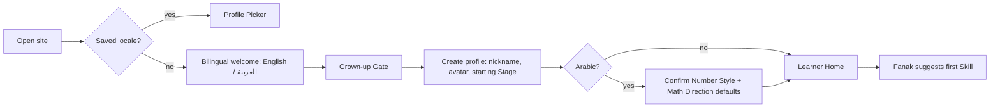
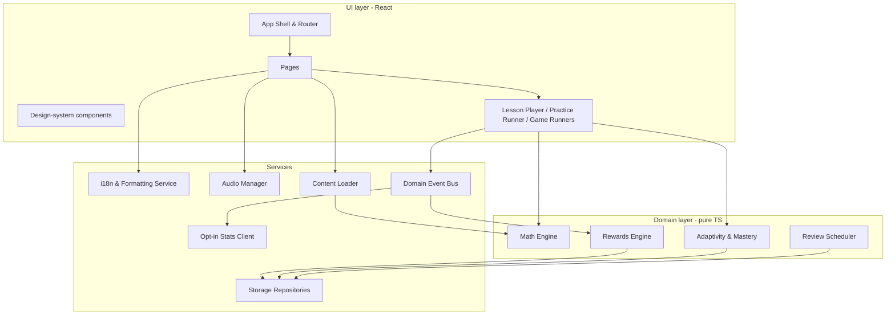

# Number Oasis — Website Architecture

| | |
|---|---|
| **Product** | Number Oasis (واحة الأرقام) |
| **Document** | `website-architecture.md` (v1.0, Draft) |
| **Date** | 14 October 2026 |
| **Companion documents** | `product-requirements.md` · `design-system.md` · `agent-instructions.md` |
| **Owns** | Site map, pages, user journeys, components, data model, technical architecture, bilingual/RTL architecture |

> Terms (Skill, Tier, Practice Set, Daily Mix, Stars, Seeds, Oasis, Trophy, Grown-ups Area, Number Style, Math Direction, etc.) are defined in `product-requirements.md` §5 and used here exactly. Feature IDs (F-xx), requirement IDs (FR-xx, CS-xx, AX-xx, NFR-xx), and Skill IDs (ADD-01 …) refer to that document.

---

## 1. Architectural principles

1. **Local-first, static, offline-capable.** MVP is a static Progressive Web App (PWA). All learner data lives in the browser (IndexedDB). No backend stores child data (A-04, CS-01).
2. **Content as data.** Skills, Lessons, Games configuration, Trophies, Oasis Stages, and all strings are versioned JSON — editable without code changes (NFR-07).
3. **Pure, tested math engine.** Question generation, checking, adaptivity, and mastery are pure TypeScript functions with no UI or storage dependencies, so they can be exhaustively tested (NFR-08).
4. **Internationalisation is structural, not cosmetic.** Locale lives in the URL, `lang`/`dir` on `<html>`, logical CSS properties everywhere, and all numbers pass through one formatting service.
5. **Event-driven rewards.** Activities emit domain events; the Rewards engine derives Seeds, Stars, and Trophies idempotently.
6. **Privacy by construction.** No third-party runtime requests; no identifiers leave the device (CS-03, CS-10, NFR-10).

---

## 2. Site map

```
/                                   → Language resolver (redirects to /en/ or /ar/)
/{locale}/                          → Welcome + Profile Picker
/{locale}/setup                     → First-run profile creation (behind Grown-up Gate)
/{locale}/home                      → Learner Home (Oasis)
/{locale}/world/{operation}         → World: Skill Path   (operation = addition|subtraction|multiplication|division)
/{locale}/skill/{skillId}           → Skill page: Lesson · Practice · Play a Game
/{locale}/lesson/{skillId}          → Lesson Player
/{locale}/practice/{skillId}        → Practice Runner
/{locale}/daily-mix                 → Daily Mix Runner
/{locale}/games                     → Games hub
/{locale}/games/{gameId}?skill={id} → Game Runner      (gameId = bubble-pop|number-line-hop|match-pairs)
/{locale}/trophies                  → Trophy Room
/{locale}/progress                  → My Progress (learner view)
/{locale}/grown-ups                 → Grown-up Gate → Grown-ups Area home
/{locale}/grown-ups/report/{profileId}
/{locale}/grown-ups/profiles
/{locale}/grown-ups/settings
/{locale}/grown-ups/data            → Backup, restore, delete
/{locale}/grown-ups/privacy         → Privacy information
/{locale}/about                     → About (for grown-ups; linked from Grown-ups Area and footer of Welcome)
/{locale}/*                         → Friendly 404 ("Fanak can't find this path")
```

- `{locale}` ∈ `en` | `ar`. URL slugs are English in both locales for stability; visible titles are localised.
- `{profileId}` appears **only** inside the Grown-ups Area. Learner routes rely on the active profile in session state, so no identifiers appear in learner URLs.
- All learner routes require an active profile; otherwise redirect to `/{locale}/`.

### 2.1 Page inventory

| Page | Purpose | Key content | Feature | Scope |
|---|---|---|---|---|
| Welcome / Profile Picker | Choose language (first run) and who is playing | Bilingual welcome, avatar cards, "Grown-ups" button | F-01, F-02 | MVP |
| Setup | Create first profile | Gate, nickname picker, avatar grid, starting Stage, Number Style (Arabic) | F-02 | MVP |
| Learner Home | Hub | Oasis scene + Seeds count, Fanak greeting, 4 World cards, Daily Mix, Trophy Room, My Progress, language switch | F-03, F-09 | MVP |
| World | Navigate Skills | Skill Path nodes (Stars, lock, review leaf), World header in Operation colour | F-04 | MVP |
| Skill page | Choose activity | Skill title, Stars, Lesson/Practice/Game buttons, Fanak recommendation | F-04 | MVP |
| Lesson Player | Teach | Step cards, manipulatives, guided tries, narration | F-05 | MVP |
| Practice Runner | Practise adaptively | Item area, answer input, progress dots, hint, summary screen | F-06 | MVP |
| Daily Mix Runner | Review | Same as Practice Runner with mixed Skills | F-07 | MVP |
| Games hub / Game Runner | Play | Game cards; game canvas; round summary | F-08 | MVP |
| Trophy Room | Celebrate | Earned and locked Trophies | F-10 | MVP |
| My Progress | Reflect | Stars per World, Mastered count, Trophies; no percentages | F-11 | MVP |
| Grown-ups Area | Manage | Report, profiles, settings, data, privacy | F-12 | MVP |

---

## 3. User journeys

### J-01 First run (grown-up with child)



### J-02 Daily learning session (learner)

1. Profile Picker → tap avatar → Learner Home (Fanak greets by nickname).
2. Fanak highlights a recommended activity: a due review (Daily Mix) or the next Skill on the furthest-progressed World.
3. Learner opens World → Skill → Lesson (if 0 Stars) → "Ready to practise" → Practice Set.
4. Summary: items correct, Seeds earned, Stars change, any Trophy celebration, Oasis growth if threshold crossed.
5. "Play a game with this skill" or "Back to my Oasis". Break reminder appears if the configured time has elapsed.

### J-03 Getting stuck and recovering

Item → wrong → gentle message + Hint 1 → retry → wrong → Worked Example → "Got it" → similar item re-queued later → Tier steps down after 2 consecutive incorrect (PRD §6.6–6.7).

### J-04 Reaching mastery

Two Tier-3 Practice Sets ≥ 90 % first-try on different days → Skill shows 3 Stars → possible Trophy (e.g. TR-04 Shining Star) → review scheduled at +7 days.

### J-05 Playing a game

Games hub → choose Game → choose from unlocked Skills (defaults to most recent) → round → summary with Seeds.

### J-06 Switching language mid-activity

Language switch in top bar → route changes `/en/practice/ADD-04` → `/ar/practice/ADD-04` → in-memory activity state (current item, attempts, Tier) is preserved → `<html lang dir>` updates → fonts/audio for new locale load → current item re-renders with new Number Style and Math Direction. No progress is lost (FR-43).

### J-07 Grown-up checks progress

"Grown-ups" button → Gate → Grown-ups Area home lists profiles → report shows Stars per Skill, 30-day accuracy, "needs help" Skills, weekly time, Trophies → optional: change settings, unlock all Skills, export backup.

### J-08 Offline use

First online visit installs service worker and caches app shell, content, fonts, and active-locale audio → subsequent sessions work offline → switching to a locale whose audio is not yet cached shows text instructions with a muted speaker icon until online.

---

## 4. Application components



| Module | Responsibility | Depends on |
|---|---|---|
| **App Shell & Router** | Locale routing, `<html lang dir>`, active-profile guard, top bar, error boundary, break-reminder timer | i18n, Store |
| **Pages** | Screen composition per §2.1 | Design-system components |
| **Design-system components** | Reusable UI per `design-system.md` §8 (Button, AnswerChoice, NumberPad, MathExpression, VerticalProblem, manipulatives, etc.) | i18n (formatting only) |
| **Lesson Player** | Renders Lesson steps from content JSON, runs guided tries, drives narration | Content, Math (checker), Audio |
| **Practice Runner** | Generates items, handles attempts/hints, applies adaptivity, emits events | Math, Adapt, Events |
| **Game Runners** | One per Game; consume the same item generator | Math, Events |
| **Math Engine** | Seeded generators per Skill/Tier, distractors, answer checker, Worked Example steps, spoken-label tokens | Content (generator specs) |
| **Adaptivity & Mastery** | Tier step up/down; Star evaluation | — |
| **Review Scheduler** | Due dates (+7/+21/+60 days); Daily Mix selection | Store |
| **Rewards Engine** | Seeds, Oasis Stage, Trophy evaluation; idempotent | Store, Content (Trophy definitions) |
| **Domain Event Bus** | Typed in-process pub/sub | — |
| **i18n & Formatting Service** | Message catalogues (ICU), number/date formatting, direction helpers | — |
| **Audio Manager** | Per-locale narration, SFX, music, independent toggles, preloading | Content |
| **Content Loader** | Loads/validates content JSON (schema-checked at build), lazy-loads per World | — |
| **Storage Repositories** | IndexedDB access, migrations, export/import, deletion | — |
| **Opt-in Stats Client** | Batches aggregate counts and sends only if the device setting is on | Store (setting) |

### 4.1 Domain events

| Event | Payload (no personal data) | Consumers |
|---|---|---|
| `lesson.completed` | profileId, skillId, guidedCorrect | Rewards, Mastery |
| `item.answered` | profileId, skillId, activity, tier, correct, firstTry, hintsUsed, durationMs | Rewards, Store |
| `practiceSet.completed` | profileId, skillId, tierMix, firstTryRate | Mastery, Rewards, Scheduler |
| `dailyMix.completed` | profileId, date | Rewards |
| `gameRound.completed` | profileId, gameId, skillId, correctCount | Rewards |
| `stars.changed` | profileId, skillId, from, to | Rewards (Trophies), Scheduler |
| `trophy.awarded` | profileId, trophyId | UI celebration |
| `oasisStage.reached` | profileId, stage | UI animation |

The Stats Client maps a whitelist of events to **aggregate counters only** (event name, skillId, tier, locale, date) and drops `profileId` (CS-10).

---

## 5. Data model

### 5.1 Static content (bundled JSON, versioned)

```ts
type Operation = 'addition' | 'subtraction' | 'multiplication' | 'division';
type Locale = 'en' | 'ar';
type SkillId = `${'ADD' | 'SUB' | 'MUL' | 'DIV'}-${string}`; // e.g. "ADD-04"

interface Skill {
  id: SkillId;
  operation: Operation;
  stage: 1 | 2 | 3 | 4 | 5;
  order: number;                     // position on the Skill Path
  prerequisites: SkillId[];          // usually the previous Skill
  scope: 'mvp' | 'future';
  titleKey: string;                  // i18n key, e.g. "skill.ADD-04.title"
  generator: GeneratorSpec;          // see §7
  formats: ItemFormat[];             // allowed item formats per Tier
  lessonId: string;
  games: GameId[];                   // supported Games
}

interface Lesson {
  id: string;
  skillId: SkillId;
  steps: LessonStep[];               // 4–7 steps
}

type LessonStep =
  | { kind: 'hook';     textKey: string; audioKey: string; illustration: string }
  | { kind: 'model';    textKey: string; audioKey: string; model: ManipulativeSpec }
  | { kind: 'guided';   textKey: string; audioKey: string; item: FixedItem }
  | { kind: 'keyIdea';  textKey: string; audioKey: string; expression?: ExpressionSpec }
  | { kind: 'ready';    textKey: string; audioKey: string };

interface TrophyDefinition { id: `TR-${string}`; titleKey: string; hintKey: string; rule: TrophyRule; icon: string }
interface OasisStageDef  { stage: 1|2|3|4|5|6|7|8|9|10; seedsRequired: number; sceneLayers: string[] }
interface GameDefinition { id: GameId; titleKey: string; itemsPerRound: number; supportedFormats: ItemFormat[] }
```

### 5.2 Learner data (IndexedDB, per device)

| Store | Key | Fields | Notes |
|---|---|---|---|
| `profiles` | `id` (UUID v4) | `nickname`, `avatarId`, `startingStage`, `createdAt`, `prefs` (see below), `unlockAll` | No real names, birthdays, gender, photos (CS-02). |
| `skillProgress` | `[profileId, skillId]` | `stars` (0–3), `currentTier` (1–3), `tier3QualifyingDates` (ISO dates), `lessonCompletedAt`, `masteredAt`, `nextReviewAt`, `reviewStep` (0–3), `unlocked` | Updated after each set/event. |
| `itemResponses` | auto id | `profileId`, `skillId`, `activity` (`lesson`\|`practice`\|`dailyMix`\|`game`), `sessionId`, `tier`, `format`, `itemSpec` (operands only), `answerGiven`, `correct`, `firstTry`, `hintsUsed`, `durationMs`, `answeredAt` | Indexed by `[profileId, skillId, answeredAt]`. Pruned after 90 days. |
| `sessions` | `id` | `profileId`, `activity`, `skillId?`, `gameId?`, `startedAt`, `endedAt`, `itemCount`, `firstTryRate`, `completed` | Supports report "time this week". |
| `rewards` | `profileId` | `seeds`, `oasisStage`, `dailyMixBonusDates` (last 30) | Single row per profile. |
| `trophyAwards` | `[profileId, trophyId]` | `awardedAt` | Primary key enforces idempotency (FR-23). |
| `counters` | `[profileId, counterId]` | `value` | e.g. `correctAfterHint`, `practiceSetsCompleted`, `dailyMixCompleted`, `distinctPracticeDays`, `gamesPlayed` (set). |
| `deviceSettings` | `'device'` | `lastLocale`, `calendar` (`gregory`\|`islamic-umalqura`), `pinHash?` (PBKDF2 + salt), `statsOptIn` (default `false`), `schemaVersion` | |

```ts
interface ProfilePrefs {
  locale: Locale;
  numberStyle: 'arab' | 'latn';          // default: ar → 'arab', en → 'latn'
  mathDirection: 'rtl' | 'ltr';          // default: ar → 'rtl', en → 'ltr'
  narration: boolean;                    // default true for Stage 1–2
  sfx: boolean;
  music: boolean;                        // default false
  calmMode: boolean;
  breakReminderMinutes: 0 | 10 | 15 | 20 | 30 | 45; // default 20
}
```

### 5.3 Data lifecycle

- **Write-through:** every `item.answered` is persisted before the next item renders (NFR-05).
- **Retention:** raw `itemResponses` older than 90 days are pruned at app start; aggregates in `skillProgress`, `rewards`, `counters` persist.
- **Persistence:** call `navigator.storage.persist()` after profile creation; show backup advice in the Grown-ups Area if not granted.
- **Export/import:** JSON file `number-oasis-backup-{nickname}-{yyyy-mm-dd}.json` with `schemaVersion`, one profile's rows, and a checksum. Import validates schema and asks before overwriting.
- **Deletion:** delete profile removes all rows with that `profileId`; "delete all" clears every store and caches of personal data (content caches remain).
- **Migrations:** versioned Dexie schema; each migration has a unit test with fixture data.

---

## 6. Recommended technical architecture

### 6.1 Stack

| Concern | Choice | Rationale |
|---|---|---|
| Language | TypeScript (strict) | Safety for math engine and content schemas. |
| UI | React 19 | Mature ecosystem, accessible component patterns. |
| Build | Vite | Fast builds, simple static output, good PWA plugin. |
| Routing | React Router (data router) | Locale-prefixed nested routes, lazy route modules. |
| State | Zustand (session/UI state) + repositories over IndexedDB | Small, explicit; persistent data stays in repositories. |
| Storage | IndexedDB via Dexie | Indexed queries, migrations, good browser support. |
| i18n | FormatJS (`react-intl`) with ICU MessageFormat | Correct Arabic plurals, built on `Intl`. |
| Styling | CSS Modules + CSS custom properties (design tokens) | Enforceable logical properties; tokens shared with `design-system.md`. |
| Animation | Motion (Framer Motion) + CSS transitions; Lottie (lazy) for Oasis growth and Trophy celebrations | Reduced-motion aware. |
| Audio | Howler.js | Reliable mobile audio, sprites for SFX. |
| PWA | `vite-plugin-pwa` (Workbox) | Precache + runtime caching. |
| Content validation | Zod schemas, validated at build | Fail the build on bad content. |
| Testing | Vitest, fast-check, Testing Library, Playwright, axe-core, Lighthouse CI | See `agent-instructions.md` §12. |
| Hosting | Static hosting with CDN (e.g. Netlify), HTTPS, preview deploys per PR | No server required for MVP. |
| Optional stats endpoint | One first-party serverless function storing daily aggregate counters | Only if F-17 is built; no IP logging. |

**Why not a server-rendered framework?** MVP has no server data and must work offline; a static SPA with prerendered locale entry pages (`/en/`, `/ar/`, `/about`) gives fast first paint and simple hosting. SSR can be revisited if public marketing pages grow.

### 6.2 Project structure

```
src/
  app/            # shell, router, providers, error boundary, break reminder
  pages/          # one folder per route
  components/     # design-system components (see design-system.md §8)
  features/
    lesson/  practice/  daily-mix/  games/{bubble-pop,number-line-hop,match-pairs}/
    rewards/ trophies/ progress/ grown-ups/ profiles/
  domain/
    math/         # generators, distractors, checker, worked examples, spoken labels
    adaptivity/   # tier controller, mastery evaluator
    scheduler/    # review & Daily Mix selection
    rewards/      # seeds, oasis, trophy rules
    events/       # typed event bus
  services/
    i18n/  formatting/  audio/  storage/  content/  stats/
  content/
    skills/*.json  lessons/*.json  trophies.json  oasis.json  games.json
  locales/
    en/*.json  ar/*.json          # message catalogues by namespace
  assets/
    audio/{en,ar}/  illustrations/  lottie/  fonts/
  styles/
    tokens.css  globals.css
tests/  e2e/  visual/  fixtures/
```

### 6.3 Code splitting and performance

- Route-level lazy loading; each Game is its own chunk; Lottie loads only on celebration screens.
- Content JSON split per World; the Learner Home loads only Skill metadata.
- Fonts subset per script and loaded per locale (`unicode-range`); audio preloaded for the current Lesson/Set only.
- Budgets (NFR-01) enforced by Lighthouse CI and a bundle-size check.

---

## 7. Math engine architecture

```
GeneratorSpec (JSON) ──► generateItem(spec, tier, rng) ──► Item
                                                     ├─► distractors(item, rng, stage)
                                                     ├─► checkAnswer(item, input) → boolean
                                                     ├─► workedExample(item) → Step[]
                                                     └─► spokenTokens(item) → Token[]  (for aria labels)
```

- **Seeded PRNG** (e.g. mulberry32) per session so any item can be reproduced from `(seed, index)` for debugging and tests.
- **Generator spec example (ADD-04):**

```json
{
  "skillId": "ADD-04",
  "template": "a + b = ?",
  "tiers": {
    "1": { "sumMax": 20, "bMax": 5, "bridgeTen": false },
    "2": { "sumMax": 20, "bMax": 5, "bridgeTen": true },
    "3": { "sumMax": 20, "aRange": [6, 9], "bRange": [6, 9], "bridgeTen": true }
  },
  "missingPosition": ["result"],
  "contexts": ["counters", "numberLine"]
}
```

- **Item model:** `{ skillId, tier, format, operation, operands: number[], blankIndex, answer: number | { quotient, remainder }, choices?: number[], seed }`. All values are integers; validation asserts PRD §6.5 at runtime in development builds and in tests always.
- **Answer checker** normalises input digits (accepts both `٠–٩` and `0–9`, ignores surrounding whitespace and grouping separators) and compares integers.
- **Adaptivity & Mastery** consume item results and return the next Tier and Star changes per PRD §6.7–6.8.
- **Scheduler** computes `nextReviewAt` and selects Daily Mix items per PRD §6.10.

---

## 8. Rewards engine

- Subscribes to domain events; computes Seeds per PRD §7.1, Oasis Stage from thresholds, and Trophy rules from `trophies.json`.
- **Idempotent:** Seeds are credited per `(sessionId, itemIndex)` and per completion event ID; Trophies use the `[profileId, trophyId]` key.
- Trophy rules are declarative, e.g.:

```json
{ "id": "TR-12", "rule": { "type": "allSkillsAtStars", "skills": ["MUL-03","MUL-04","MUL-05","MUL-06"], "stars": 3 } }
```

Rule types: `firstEvent`, `counterAtLeast`, `allSkillsAtStars`, `skillAtStars`, `oasisStageAtLeast`, `distinctGamesPlayed`.

---

## 9. Bilingual and RTL/LTR architecture

### 9.1 Locale resolution and routing

1. `/` resolves the locale in order: saved `deviceSettings.lastLocale` → active profile's `prefs.locale` → `navigator.languages` (first match of `ar*` → `ar`, otherwise `en`) → `en`.
2. Every route is locale-prefixed. The router sets `<html lang="en" dir="ltr">` or `<html lang="ar" dir="rtl">` before first paint (inline-free: set in the prerendered HTML per locale and updated by the shell on switch).
3. Prerendered entry pages include `<link rel="alternate" hreflang="en|ar|x-default">`.

### 9.2 Message catalogues

- ICU MessageFormat JSON per namespace (`common`, `home`, `lesson`, `practice`, `games`, `rewards`, `grownups`, `skills`, `trophies`).
- Keys are semantic and identical in both locales (e.g. `practice.feedback.tryAgain`); a CI check enforces **key parity** and ICU argument parity.
- Arabic plurals use all CLDR categories (`zero`, `one`, `two`, `few`, `many`, `other`). Example:

```json
{
  "rewards.seeds.earned": "{count, plural, =0 {لا بذور هذه المرة} one {حصلنا على بذرة واحدة!} two {حصلنا على بذرتين!} few {حصلنا على # بذور!} many {حصلنا على # بذرة!} other {حصلنا على # بذرة!}}"
}
```

English: `"{count, plural, =0 {No seeds this time} one {You got # seed!} other {You got # seeds!}}"`.

- Learner-facing Arabic uses "let's/we" phrasing to avoid gendered imperatives (FR-44).

### 9.3 Number formatting

All numbers in UI and math go through `services/formatting`:

```ts
formatNumber(n, { locale, numberStyle }) =>
  new Intl.NumberFormat(locale === 'ar' ? 'ar-SA' : 'en', {
    numberingSystem: numberStyle,   // always explicit: 'arab' or 'latn'
    useGrouping: 'min2',            // no separator below 10,000 (e.g. 3456); separator from 5 digits
  }).format(n);
```

- Always pass `numberingSystem` explicitly; never rely on locale defaults, which differ across browsers and CLDR versions.
- Eastern Arabic uses `٬` (U+066C) as thousands separator when grouping applies.
- The Number Pad shows digits in the active Number Style; physical keyboard input accepts both digit sets.

### 9.4 Date and time formatting (Grown-ups Area only)

- `Intl.DateTimeFormat(locale, { calendar, numberingSystem, dateStyle: 'medium' })` with `calendar` = `gregory` (default) or `islamic-umalqura` (Arabic option, FR-33).
- Relative dates via `Intl.RelativeTimeFormat` ("2 days ago" / "قبل يومين").
- "This week" uses a locale week start: Sunday for `ar-SA` and `en` by default; derived from `Intl.Locale.prototype.getWeekInfo` where available.
- "Different calendar days" for mastery uses the device's local date (Gregorian, `YYYY-MM-DD`), independent of the display calendar.

### 9.5 Math layout under bidirectional text

Math expressions are **never** raw strings. The `MathExpression` component renders a token list:

```ts
type Token = { t: 'num'; v: number } | { t: 'op'; v: '+' | '−' | '×' | '÷' } | { t: 'eq' } | { t: 'blank' };
// 7 + 5 = ? → [{t:'num',v:7},{t:'op',v:'+'},{t:'num',v:5},{t:'eq'},{t:'blank'}]
```

| Rule | English (`ltr`) | Arabic default (`rtl`, `arab`) | Arabic with Math Direction `ltr` |
|---|---|---|---|
| Container `dir` | `ltr` | `rtl` | `ltr` |
| Visual order of `7 + 5 = ?` | `7 + 5 = ?` | `? = ٥ + ٧` (read right-to-left as "٧ زائد ٥") | `٧ + ٥ = ?` |
| Each multi-digit number | Wrapped in `<bdi dir="ltr">` so digits keep most-significant-first order (e.g. ٣٤ is never shown as ٤٣) | same | same |
| Operator glyphs | `+ − × ÷ =` (U+2212 for minus) | same glyphs; not mirrored | same |
| Accessible name | ICU message "{a} plus {b} equals what?" | "{a} زائد {b} يساوي كم؟" | same as Arabic |

**Column (vertical) problems** (`VerticalProblem`):

- Digits are always right-aligned by place value (ones in the rightmost column) in every locale.
- The operator sign sits on the inline-start side of the bottom operand when Math Direction is `ltr` (left), and on the right when `rtl`. (Pending OQ-01 validation.)
- Answer entry starts at the ones column and moves toward higher place values after each digit, in every locale; arrow keys move visually.
- Carry/borrow marks sit above the relevant column.

**Number lines** (`NumberLine`): orientation follows Math Direction — `ltr` places 0 at the left, `rtl` places 0 at the right; jump arrows and Fanak's facing direction follow. (Pending OQ-01.)

**Long division** (DIV-08, Future) needs locale-specific notation; the component must accept a `notation` variant rather than mirroring the English layout.

### 9.6 Layout mirroring

- All spacing, alignment, borders, and positioning use **logical CSS properties** (`margin-inline-start`, `padding-inline`, `inset-inline-end`, `text-align: start`). Physical left/right properties are lint errors (see `agent-instructions.md` §6).
- Flex/grid rows follow `dir` automatically; progress bars fill from inline-start.
- Directional icons (back/forward, chevrons, "next" arrows) mirror via a `mirrorInRtl` prop; non-directional icons (play/pause, checkmark, star, speaker, clock) never mirror. Full list in `design-system.md` §7.
- The Number Pad grid is **not** mirrored (1-2-3 on the top row left-to-right, matching phone keypads); its backspace icon mirrors.

### 9.7 Fonts, audio, and assets per locale

- Font families switch by `:lang()` selectors; only the active locale's font files are requested.
- Audio lives at `assets/audio/{locale}/{audioKey}.mp3` (+ `.ogg` fallback); missing audio degrades to on-screen text without errors.
- Illustrations avoid embedded text. Where text is unavoidable (e.g. a sign in the Oasis), provide per-locale variants.

### 9.8 Language switching

- The language switch shows the *other* language's name in that language ("العربية" in English UI, "English" in Arabic UI) with a globe icon.
- Switching: update profile `prefs.locale` and `deviceSettings.lastLocale` → navigate to the same path under the new prefix (`replace` history) → shell updates `lang`/`dir`, loads catalogues and fonts → activity state (held in Zustand, keyed by route) persists → audio switches to the new locale for the next narration.
- Number Style and Math Direction defaults apply the first time a profile uses Arabic; afterwards the saved values are kept.

---

## 10. Offline and PWA

| Asset | Strategy |
|---|---|
| App shell (HTML, JS, CSS) | Precache, versioned; update prompt shown on Learner Home ("A new version is ready") — never mid-activity |
| Content JSON | Precache |
| Fonts (both locales) | Precache active locale; runtime cache the other on first switch |
| Illustrations, Lottie | Precache MVP set |
| Audio | Precache active locale's narration and SFX after first idle period; cache-first |
| Optional stats endpoint | Network-only; queued counts are dropped if offline for > 7 days |

Web app manifest: localised `name`/`short_name` via separate manifests per locale (`/en/manifest.webmanifest`, `/ar/manifest.webmanifest` with `dir: "rtl"`, `lang: "ar"`), `display: standalone`, child-friendly icons, `orientation: any`.

---

## 11. Security and privacy architecture

- **CSP:** `default-src 'self'; img-src 'self' data:; media-src 'self'; connect-src 'self'; font-src 'self'; script-src 'self'; style-src 'self'; frame-ancestors 'none'; base-uri 'self'; form-action 'self'`.
- Headers: HSTS, `Referrer-Policy: no-referrer`, `Permissions-Policy` denying camera, microphone, geolocation, payment, and other unused features.
- No third-party scripts, fonts, analytics, or CDNs at runtime (fonts self-hosted).
- PIN stored as PBKDF2 hash with salt in `deviceSettings`; never displayed or exported.
- Backup files contain no PIN, no device settings beyond `schemaVersion`.
- The optional stats endpoint accepts only whitelisted aggregate counters, rejects unknown fields, and does not log IP addresses.

---

## 12. Environments and deployment

| Environment | Purpose |
|---|---|
| Local | Dev server with mock content toggles and a debug panel (seed replay, Tier override) — excluded from production builds |
| Preview | Per-pull-request static deploy for design/QA review in both locales |
| Production | Static CDN with security headers; atomic deploys and instant rollback |

**Future:** package the same PWA as an Android app via a Trusted Web Activity for Google Play (Families policy compliance, Digital Asset Links), reusing production builds.

---

## 13. Future architecture (not MVP)

| Enhancement | Architectural impact |
|---|---|
| Grown-up account + cloud sync | Add auth for grown-ups only, an API with end-to-end-encrypted profile blobs, conflict resolution (last-writer-wins per store with merge for counters), explicit parental consent flow. |
| Teacher dashboards | Separate tenant model, roster without child PII (class codes + nicknames), school data-processing agreements. |
| Dynamic read-aloud of numbers | Arabic number-to-words generator with gender agreement, or recorded number-clip concatenation. |
| Additional locales | Already supported by catalogues and logical layout; add fonts, audio, and plural rules. |

---

## 14. Key architecture decisions

| ADR | Decision | Status |
|---|---|---|
| ADR-01 | Local-first PWA, no child accounts in MVP | Accepted |
| ADR-02 | Locale in URL prefix; `dir` on `<html>` | Accepted |
| ADR-03 | Math expressions rendered from tokens with configurable Math Direction and bidi-isolated numbers | Accepted (defaults pending OQ-01) |
| ADR-04 | `Intl` with explicit `numberingSystem` for all numbers | Accepted |
| ADR-05 | Event-driven, idempotent Rewards engine | Accepted |
| ADR-06 | Logical CSS properties only, enforced by lint | Accepted |
| ADR-07 | Content as schema-validated JSON | Accepted |
